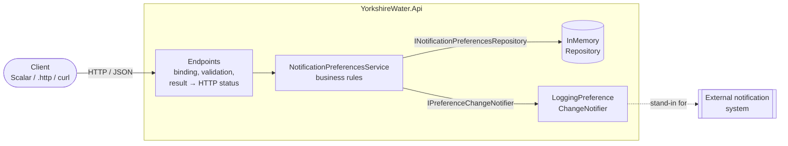
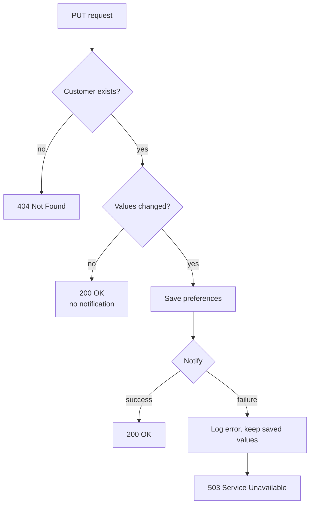

# Yorkshire Water: Customer Notification Preferences API

A small ASP.NET Core (.NET 10) minimal API that lets a customer view and update their email and SMS
notification preferences. When a preference actually changes, the external notification system is
informed. The solution was built test-first, one small step per commit.
See [DESIGN.md](DESIGN.md) for the design decisions and what I would improve.

## Prerequisites

- [.NET 10 SDK](https://dotnet.microsoft.com/download/dotnet/10.0)

## Build, test, run

```bash
dotnet build
dotnet test
dotnet run --project YorkshireWater.Api
```

The API listens on `http://localhost:5227` (see `YorkshireWater.Api/Properties/launchSettings.json`).
The `https` profile also listens on `https://localhost:7025`.

The API must be running before you send requests to it, whichever of the options below you use.
The tests don't need it running, because they host the app in memory.

## Trying it out

| Option | How |
|--------|-----|
| **Scalar UI** | Run from Visual Studio or Rider (F5) and the browser opens on `http://localhost:5227/scalar`. You can also navigate there yourself. Served in the Development environment only. |
| **OpenAPI document** | `http://localhost:5227/openapi/v1.json` (Development only) |
| **`.http` file** | `YorkshireWater.Api/YorkshireWater.Api.http` has a request for every main scenario. Visual Studio and Rider run it as-is; VS Code needs the REST Client extension. |
| **curl** | See the examples below. |

## Seeded customers

On startup the in-memory store is seeded with two customers (see `Infrastructure/SeedData.cs`):

| Customer | ID                                     | emailEnabled | smsEnabled |
|----------|----------------------------------------|--------------|------------|
| Josh     | `11111111-1111-1111-1111-111111111111` | true         | false      |
| Steve    | `22222222-2222-2222-2222-222222222222` | false        | true       |

State is held in memory only and resets when the application restarts.

## Endpoints

### `GET /api/customers/{customerId}/notification-preferences`

```bash
curl http://localhost:5227/api/customers/11111111-1111-1111-1111-111111111111/notification-preferences
```

```json
{ "customerId": "11111111-1111-1111-1111-111111111111", "emailEnabled": true, "smsEnabled": false }
```

### `PUT /api/customers/{customerId}/notification-preferences`

Both properties are required. If either is missing the API returns 400 and never defaults it to `false`.

```bash
curl -X PUT http://localhost:5227/api/customers/22222222-2222-2222-2222-222222222222/notification-preferences \
     -H "Content-Type: application/json" \
     -d '{ "emailEnabled": true, "smsEnabled": true }'
```

```json
{ "customerId": "22222222-2222-2222-2222-222222222222", "emailEnabled": true, "smsEnabled": true }
```

When at least one value changes, the notification system is informed. The current notifier is a
logging stub, so the request shows up in the API console:

```
info: YorkshireWater.Api.Infrastructure.LoggingPreferenceChangeNotifier[0]
      Notification requested for customer 22222222-2222-2222-2222-222222222222: email=True, sms=True
```

If the values are unchanged, the API returns 200 and sends no notification.

### Responses

| Status | When                                                                        |
|--------|-----------------------------------------------------------------------------|
| 200    | Preferences returned or updated                                             |
| 400    | `customerId` is not a GUID, the body is missing or malformed, or a property is missing |
| 404    | The customer does not exist (`PUT` never creates customers)                  |
| 503    | The preferences were saved but the notification system failed (see below)   |

All errors use the standard `application/problem+json` shape. If a well-formed body is missing a
property, the error names it:

```json
{
  "title": "One or more validation errors occurred.",
  "status": 400,
  "errors": { "SmsEnabled": [ "The SmsEnabled field is required." ] }
}
```

If the body can't be read as JSON, or `customerId` isn't a GUID, `detail` explains the problem:

```json
{
  "title": "Bad Request",
  "status": 400,
  "detail": "Failed to bind parameter \"Guid customerId\" from \"not-a-guid\"."
}
```

## Architecture



The API has three thin layers, and each has one job:

- **Endpoints** (minimal APIs) deal with HTTP only: binding, validation, and mapping each outcome
  to a status code. Typed results (`Results<Ok<T>, ProblemHttpResult>`) make the possible
  responses explicit.
- **Service** owns the business rules: the customer must exist, only a real change is stored,
  the notifier is called exactly once per change, and a notifier failure becomes an explicit outcome.
- **Infrastructure** provides the in-memory repository and a logging stand-in for the notification
  system. Both sit behind interfaces in `Domain/` and are registered with the built-in DI container,
  so either can be replaced without touching the service.

Some design choices worth calling out:

- `NotificationPreferences` is a record, so value equality detects whether anything changed.
- `UpdateAsync` returns a closed result type (`Updated`, `CustomerNotFound`, `NotificationFailed`)
  instead of throwing. An unknown customer isn't treated as exceptional, and the endpoint has to
  handle every case.
- The request DTO uses `bool?` with `[Required]`, so a missing property fails validation instead of
  binding as `false`. Validation uses .NET 10's `AddValidation()`.
- The route has no `:guid` constraint on purpose. A constraint would turn a malformed id into a 404;
  without one, the binding failure becomes the 400 the spec asks for.
- `ThrowOnBadRequest` plus the exception handler turn binding failures into problem-details
  responses instead of the framework's default empty 400.

## Notification failure policy



The update is saved **before** the notification system is called. If that call fails, the saved
values are kept and the client gets a **503** problem-details response. Rolling back would discard
a change the customer asked for, and blocking the save on the notifier would tie the two systems'
availability together. The trade-off is that the downstream system can fall out of date: retrying
with the same body won't notify again, because nothing has changed. In production I'd move the
notification to a transactional outbox or a queue with retries.

## Tests

```bash
dotnet test
```

- **Unit tests** (`YorkshireWater.Tests/Unit`) cover the repository and the service in isolation.
  Moq stands in for the repository and notifier, so the tests can check interactions such as
  "notified exactly once" and "never notified".
- **Integration tests** (`YorkshireWater.Tests/Integration`) boot the real application with
  `WebApplicationFactory<Program>` and test each acceptance criterion over HTTP. Only the notifier
  is replaced with a mock; routing, binding, validation, the endpoints, the service and the store
  are all real. Each test gets a fresh application, so in-memory state can't leak between tests.

The tests check observable behaviour (status code, body, stored state, notifier calls) rather than
implementation details.

## How it was built

The commit history follows a test-first progression:

1. Scaffolded the solution, removed the template defaults, and moved shared build properties
   into `Directory.Build.props`.
2. Wrote failing tests for the in-memory repository, then the model and repository to pass them.
3. Added the service: get, update and change notification, then skipping unchanged values and
   handling notifier failure.
4. Added the GET endpoint and integration tests through the real HTTP stack.
5. Added the PUT endpoint, then request validation and problem details for binding failures.
6. Added OpenAPI and the Scalar UI for easier manual testing, plus the sample `.http` requests.
7. Fixed a notifier timeout returning 500 instead of 503, found in a final AI review of the code
   (see [AI assistance](#ai-assistance)).

## Project layout

```
YorkshireWater.Api
  Contracts/        request/response DTOs
  Domain/           model, result type and the repository/notifier interfaces
  Endpoints/        HTTP layer (minimal API endpoints)
  Infrastructure/   in-memory repository, seed data, logging notifier stub
  Services/         business rules
YorkshireWater.Tests
  Unit/             repository and service tests
  Integration/      end-to-end HTTP tests via WebApplicationFactory
```

## Known limitations

- No authentication or authorisation (out of scope).
- In-memory store: state is lost on restart, and the last write wins because there's no
  concurrency control (an ETag with `If-Match` would fix this).
- The service reads and then writes. With a real database the update would be conditional on the
  row still existing.
- The OpenAPI document only lists the 200 response for each endpoint; 400/404/503 aren't listed yet.

## AI assistance

Before starting, I used AI to break the project into small, self-contained steps, so that
reviewers can follow the commit history one change at a time, with each commit adding a feature
together with its tests (see [How it was built](#how-it-was-built)).

I also used AI to draft this README and DESIGN.md, based on the code and the commit history.

As a final step I had an AI review the finished code. It found one bug: a notifier timeout
(`TaskCanceledException`) was treated as a caller cancellation, so the API returned 500 instead of
503, even though the preferences had already been saved. The bug-fix commit addresses this. The service
now only lets a cancellation through when the request itself was cancelled, and any other notifier
failure, including a timeout, returns 503. That commit also adds tests for a timeout returning 503
and for a real cancellation still being passed on.
